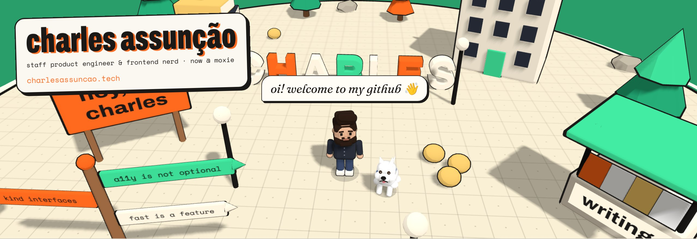

<a href="https://charlesassuncao.tech">
  <picture>
    <source media="(prefers-color-scheme: dark)" srcset="./assets/banner-dark.jpg">
    
  </picture>
</a>

  <a href="https://charlesassuncao.tech">website</a> ·
  <a href="https://charlesassuncao.tech/#writing">writing</a> ·
  <a href="https://www.linkedin.com/in/charlesassuncao/">linkedin</a> ·
  <a href="https://dev.to/assuncaocharles">dev.to</a> ·
  <a href="https://charlesassuncao.tech/uploads/Charles_Assuncao_CV.pdf">cv</a>

### oi, i'm charles 👋

Brazilian frontend engineer from Belo Horizonte, shipping for the web since 2014. I care about **kind interfaces**: accessible, fast and honest, for the people using them and the people maintaining them next year.

- 🏥 **Now:** Staff Product Engineer at [Moxie](https://www.linkedin.com/company/86900524/), building clinical and business software for 1,500+ aesthetic practices. React, Next.js, GraphQL, Django and AI features in production.
- 🚀 **Before:** Staff Engineer at [Appcues](https://www.appcues.com) (TypeScript and Vite migrations, a 60% smaller bundle and 4× faster loads), [Fluent UI](https://github.com/microsoft/fluentui) components for Microsoft Teams at Microsoft in Prague, and credit-risk dashboards at Credit Suisse in Warsaw.
- ♿ **a11y is not optional:** I've built accessibility tooling that gates PRs, and I contribute to [W3C Open UI](https://open-ui.org).
- 📦 **Open source:** author of [ngx-indexed-db](https://github.com/assuncaocharles/ngx-indexed-db) (IndexedDB for Angular, ~18k weekly downloads) and [react-indexed-db](https://github.com/assuncaocharles/react-indexed-db).
- 🐶 **Off the clock:** walking Bug the westie, writing about engineering and philosophy, and defending pão de queijo as a valid lunch.
- 🎩 **Fun fact:** I worked as a magician before I wrote code.

### 🛠️ Toolbox

`TypeScript` `React` `Next.js` `GraphQL` `Django` `Python` `Elixir` `Angular` `design systems` `accessibility` `web performance` `three.js` `LLM features`

### 📕 Latest writing

<!-- BLOG-POST-LIST:START -->
- [The Engineer in the Age of AI: Why Judgment Is the New Craft](https://charlesassuncao.tech/blog/2026-05-23-the-engineer-in-the-age-of-ai-why-judgment-is-the-new-craft/)
- [O Engenheiro na Era da IA: Por Que o Julgamento Virou a Nova Moeda](https://charlesassuncao.tech/blog/2026-05-23-o-engenheiro-na-era-da-ia-por-que-o-julgamento-virou-a-nova-moeda/)
- [Introducing Maestrio: feedback to PR in minutes](https://charlesassuncao.tech/blog/2026-04-25-introducing-maestrio-feedback-to-pr-in-minutes/)
- [Ler Descartes Hoje: Dúvida, Método e a Coragem de Pensar por Conta Própria](https://charlesassuncao.tech/blog/2025-12-24-ler-descartes-hoje-d%C3%BAvida-m%C3%A9todo-e-a-coragem-de-pensar-por-conta-pr%C3%B3pria/)
- [Protesto contra as certezas](https://charlesassuncao.tech/blog/2025-11-11-protesto-contra-as-certezas/)
<!-- BLOG-POST-LIST:END -->

➜ more at <a href="https://charlesassuncao.tech/#writing">charlesassuncao.tech</a> and <a href="https://dev.to/assuncaocharles">dev.to/assuncaocharles</a>

